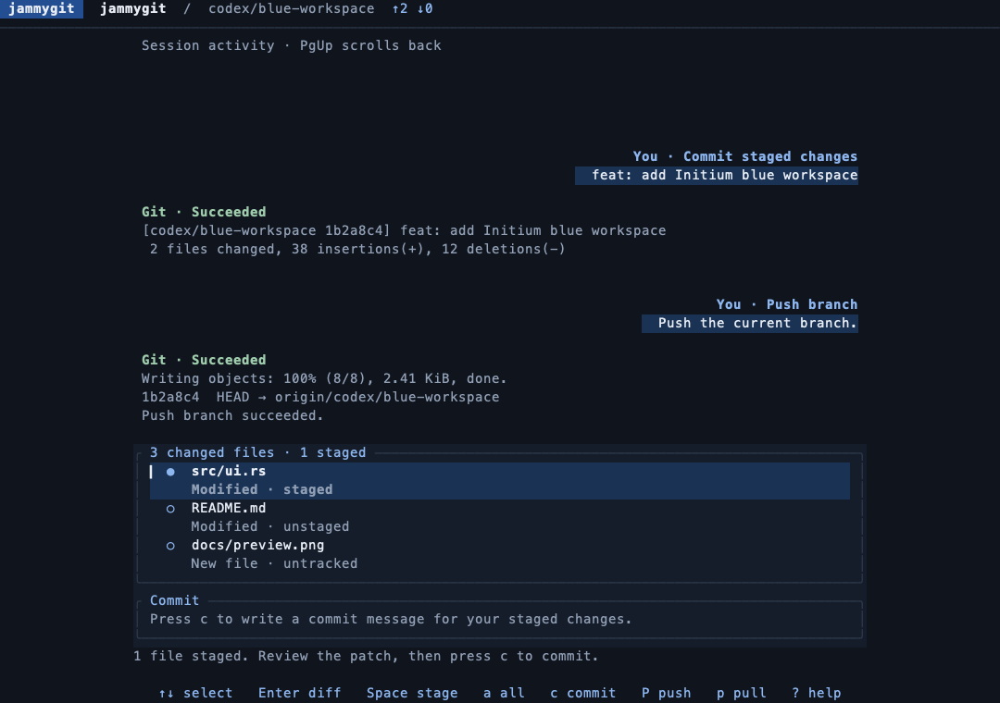

# jammygit

A small Git TUI built with [Ratatui](https://ratatui.rs/). Stage, review, commit, push, pull. Uses the installed Git CLI and your existing Git configuration, credentials, hooks, and signing setup.

The interface takes its blue (`#234e91`) from Initium. Changed files sit in a central conversation-style view, with commit input in a composer below. Use the arrow keys to select a file and Enter to slide in its diff from the right. Commits, pushes, and pulls form a scrollable conversation above the current files and composer, with each request, result, and Git output kept for the current session. Prompts stay inside the app too.



## Install a release

Releases contain native binaries for macOS (Apple Silicon and Intel, macOS 11+) and Linux (ARM64 and x86-64). Linux binaries are statically linked with musl. Rust is not needed to install a release; Git must already be on your PATH.

For a public repository, once the first release is published:

```sh
curl -fsSL https://github.com/initiumailab/jammygit/releases/latest/download/install.sh | bash
```

For a private repository, use authenticated [GitHub CLI](https://cli.github.com/):

```sh
jammygit_installer_dir="$(mktemp -d)"
gh release download --repo initiumailab/jammygit --pattern install.sh --dir "$jammygit_installer_dir"
bash "$jammygit_installer_dir/install.sh"
rm -rf "$jammygit_installer_dir"
```

The installer detects your platform, downloads the matching archive, verifies SHA-256 and the binary version, then installs atomically to `~/.local/bin/jammygit`. It uses authenticated `gh` when available, otherwise curl for public releases. It requires no sudo and leaves shell configuration files alone. If needed, it prints the command to add the installation directory to PATH. `NO_COLOR=1` disables color and animated progress.

To pin a version or choose a directory after downloading the installer:

```sh
bash install.sh --version v0.1.0 --bin-dir "$HOME/.local/bin"
```

Run `bash install.sh --help` for all options, including installing from a fork with `--repo OWNER/REPO`.

## Run from source

Requires a current stable Rust toolchain, Git 2.23+, and an interactive terminal (at least 64 × 18; 100 × 30 recommended).

```sh
cd /Users/sam/code/initiumailab/jammygit
cargo run --release -- /path/to/your/repository
```

The path is optional; it defaults to the current directory. Subdirectories and linked Git worktrees work too. To install the command:

```sh
cargo install --path . --locked
jammygit /path/to/your/repository
```

## Keys

| Key | Action |
| --- | --- |
| `j` / `k`, arrows | Select a changed file |
| `Enter` / Right | Slide in the selected file's diff |
| `Esc` / Left | Close the diff drawer |
| `Space` | Stage selected file; unstage if fully staged |
| `u` | Unstage selected file, preserving working files |
| `a` | Stage all changes, or unstage all when everything is already staged |
| `Tab` | Switch staged / unstaged diff |
| `v` | Switch selected-file / all-files diff |
| `J` / `K`, Page Down / Up | Scroll session activity, or the diff while its drawer is open |
| Mouse wheel | Scroll activity or the diff under the pointer |
| `Home` / `End` | Oldest activity / return to latest (drawer closed) |
| `h` / `l` | Pan the diff horizontally |
| `c` | Write a message and commit staged changes |
| `P` | Push the current branch immediately, inside the app |
| `p` | Pull immediately inside the app, fast-forward only |
| `o` | Show / hide session activity |
| `g` | Recent commits |
| `r` | Refresh |
| `?` | Help |
| `q` / `Ctrl+C` | Quit |

In the commit composer, `Enter` commits, `Ctrl+J` or `Alt+Enter` inserts a newline, and `Esc` returns to the file list with the draft saved. Left/right, Home/End, Backspace/Delete, and `Ctrl+U` edit the message. Bracketed paste supports multiline messages in compatible terminals. Failed commits keep the draft for retry; successful commits clear it.

Each file has a readable status: staged, unstaged, partly staged, untracked, or conflicted. A filled marker indicates staged content. Staging a file stages all its current changes; partial staging belongs in `git add -p` outside the app. The diff drawer automatically picks the staged view for files with only staged changes. On narrow terminals the drawer occupies the full content width; Esc returns to the file list.

`a` toggles all files immediately: any unstaged or untracked changes cause everything to be staged; when all changes are staged, it unstages everything. Unstaging preserves working files, including before the first commit.

## Commit, push, and pull behavior

- **Commit:** only the existing index is committed. No automatic staging, amend, or hook/signing bypass. The staged index is checked again when you submit the message. Empty messages and unresolved conflicts are rejected.
- **Push:** starts immediately with `P`. The output pane shows the remote, branch, and destination URL (with URL credentials hidden). The app sends one explicit branch refspec, without force, extra tags, wildcard refspecs, or mirror behavior. Remote rejections remain failures. Multiple push URLs are rejected. A first push sets the upstream after success.
- **Pull:** requires an upstream and runs an explicit fast-forward-only pull with rebase, squash, and autostash disabled. Local staged, unstaged, and untracked changes are allowed; Git decides whether the incoming update can be applied safely. If incoming changes would overwrite local work, Git stops and its error stays visible in the app. Divergent history also stops with Git's error; resolve it using your preferred Git workflow outside the app.
- **Commit/push/pull output and prompts:** run in an embedded terminal while the TUI stays open and responsive, with no extra confirmation or return prompt. Each operation keeps its request, success/failure, and output in the session timeline; `o` hides/reopens the timeline, and Enter opens a selected file's diff. If Git, SSH, signing, or a hook asks for input, press `i`, type your response, and press Enter. `Esc` leaves input mode; `Ctrl+C` interrupts Git while keeping the app open. Other mutations and quitting are blocked until Git finishes. Live output has a bounded queue and 1,000 lines of scrollback. The timeline keeps up to 100 actions and 10,000 archived output lines in memory and resets when you quit. Page Up/Down, `K`/`J`, and the mouse wheel scroll it; Home shows the oldest activity and End follows the latest again. Reading earlier activity keeps your place as new output arrives. Success appears only after Git exits successfully; failures retain their Git output.
- **State checks:** repository state and the resolved remote URL are rechecked immediately before execution. Stale confirmations are rejected. Avoid running simultaneous Git mutations in another process; preflight checks cannot lock out external Git commands.

Push target selection honors `branch.<name>.pushRemote`, then `remote.pushDefault`, then the branch upstream. Without an upstream or override, it uses `origin`, or the sole configured remote. An existing upstream supplies its remote branch name; a different push remote uses the local branch name. Pull always uses the configured upstream. Custom `push.default` policies and configured push refspecs are replaced by this explicit single-branch behavior.

Status refreshes in the background every three seconds while no dialog or Git operation is active, and again after an operation finishes. Ahead/behind counts use local tracking refs; there is no automatic network traffic. Pull fetches current remote state. Large diff previews are limited to 256 KiB. Untracked files must be staged to preview their patch.

Navigation and typing do not run Git commands on the UI thread. Status, diff reads, staging, and operation preparation use background workers. Diffs are loaded only while their drawer is open, briefly coalesced during fast navigation, and cached for the current repository view. Late responses cannot replace a newer selection. Only visible file, diff, and conversation rows are rendered; completed activity wraps are cached, and unchanged idle screens are not redrawn.

This first version leaves branch switching, conflict resolution, merge/rebase continuation, stashing, and force pushes to Git. In-progress merge, rebase, cherry-pick, revert, sequencer, and bisect operations block commit/push/pull with an explanation. You can still stage conflict resolutions.

## Development

```sh
cargo fmt --check
cargo clippy --all-targets -- -D warnings
cargo test
cargo build
python3 scripts/smoke_test.py
python3 -m unittest discover -s tests -p 'test_release*.py' -v
```

To measure navigation handlers and rendering with 5,000 changed files:

```sh
cargo test --release interaction_benchmark -- --ignored --nocapture
```

This reports handler and Ratatui frame timings, not network-operation duration or a terminal emulator's display latency.

The UI lives in `src/ui.rs`. To regenerate the sample screenshot on macOS:

```sh
JAMMYGIT_PREVIEW_DIR=/tmp/jammygit-preview cargo test export_preview -- --ignored
swift scripts/render_preview.swift /tmp/jammygit-preview/workspace.cells docs/preview.png
swift scripts/render_preview.swift /tmp/jammygit-preview/diff.cells docs/diff-preview.png
```

This renders the actual Ratatui cell buffer, including its colors, into a PNG. The preview exporter also produces compact, open-drawer, commit-composer, and Git-activity screens for visual review.

Workflow tests use disposable repositories and local bare remotes. They cover staged-only and first commits, Unicode messages, rejected hooks, unusual filenames, renames, stale confirmations, push destinations, rejected pushes, fast-forward and diverged pulls, conflicts, and linked worktrees. Embedded-terminal tests cover commits, prompts, input, resizing, failure output, and interruption. UI tests cover arrow-key selection, drawer controls, retained action results, timeline scrolling and resizing, and draft retention after a rejected commit. The Unix PTY smoke test (Python 3.11+) drives the actual TUI through stage → multiline commit with an embedded hook prompt → one-key push with another embedded prompt → one-key pull. It verifies all three operations stay in the TUI, earlier activity remains scrollable after later actions, and the terminal is restored on exit. Real hosting-provider authentication and signing depend on your local Git setup.

## Publishing a release

After this project and its workflows are committed and pushed to GitHub, push a version tag matching `Cargo.toml`:

```sh
git tag v0.1.0
git push origin v0.1.0
```

The release workflow runs CI first, then builds and exercises four native release binaries. It publishes these archives with `install.sh` and `SHA256SUMS`:

| Platform | Asset |
| --- | --- |
| macOS Apple Silicon | `jammygit-aarch64-apple-darwin.tar.gz` |
| macOS Intel | `jammygit-x86_64-apple-darwin.tar.gz` |
| Linux ARM64 | `jammygit-aarch64-unknown-linux-musl.tar.gz` |
| Linux x86-64 | `jammygit-x86_64-unknown-linux-musl.tar.gz` |

Only the publish job has write access, using the built-in `GITHUB_TOKEN`; no release token secret is needed. Archives are reproducible for the same binary and source files. All assets are uploaded to a draft before it is published, so incomplete uploads stay unpublished. Reruns can repair a draft but will not overwrite a published release. Prerelease versions such as `0.2.0-rc.1` are marked as prereleases and do not replace the latest stable release.

For subsequent versions, update the package version in `Cargo.toml` and `Cargo.lock`, commit the changes, then push the matching `v…` tag. A mismatched tag fails before packaging.
